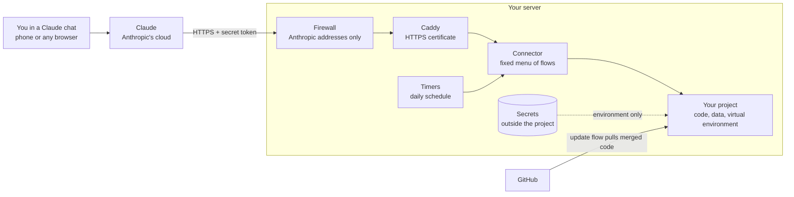

# How funaibuddy-lab works

## The problem

The scripts behind a blog series need three things a chat window does not have:
a private API key, an always-on computer, and somewhere to keep data between
runs. The usual workaround is copy and paste: Claude writes a command, you run
it on a laptop, you paste the output back. This lab removes the copy and paste
without giving an AI a free hand on a server.

## The pieces

| Piece | What it is | Why it is there |
|---|---|---|
| **Connector** | A small Python program speaking MCP (Model Context Protocol, the standard way Claude talks to outside tools) | Offers seven tools: list flows, run a flow, check a job, last run, lab status, list files, read a file |
| **flows.yaml** | One settings file listing every command that may run | It is the whole permission system: not in the file, not runnable |
| **Caddy** | A web server that fetches and renews the HTTPS certificate by itself | Encrypts the connection and turns away any address that is not Anthropic's |
| **Docker** | Packaging that runs the connector in its own sealed box | The same box runs identically on any server, and the box cannot touch the rest of the machine |
| **Timers** | The server's built-in scheduler (systemd) | Runs scheduled flows, such as the daily check, through the same connector code |
| **`lab` command** | A short upkeep script | Status, logs, updates, secrets, token rotation |

## What happens when you ask Claude to run something

1. You type: *"Run the nightly dry run."*
2. Claude calls the connector's `run_flow` tool with `project=thesis-monitor`, `flow=nightly-dry-run`.
3. The request leaves Anthropic's cloud. Your location plays no part, so it
   works the same from home, a hotel or a phone.
4. The firewall lets it in only because it comes from Anthropic's published address range.
5. The connector checks the secret token, then looks the flow up in `flows.yaml`.
6. Any parameter is checked against its pattern. The command runs as a list of
   words, never through a shell, so punctuation in a parameter cannot become a second command.
7. Keys are handed to the script through its environment. Before the output
   goes back, every secret value is replaced with `[hidden]`.
8. The run is written to the audit log. Short flows answer directly; long ones
   return a job number that Claude checks again.

## Design choices

**A menu, not a terminal.** A general "run this command" tool would be more
flexible and far riskier. Documents the scripts read (filings, research notes)
can contain text written to trick an AI. With a fixed menu, the worst a tricked
AI can do is run one of your own flows.

**Code changes go through GitHub.** The connector cannot edit code. A change is
a pull request you merge; the `update` flow then pulls it. Every change is
reviewed and has a history.

**Secrets live outside the project.** The key file sits in `/srv/lab/secrets`,
readable only by the connector's own user, and the file-reading tool refuses
anything outside the project folder.

**One command to rebuild.** Everything about the server is in this repository
or typed in during setup. Nothing is configured by hand and forgotten.

**Docker and a skill do different jobs.** Docker makes the server repeatable.
The [skill](../skill/SKILL.md) is a page of instructions that makes any Claude
chat good at using and maintaining it. Neither costs anything.

## What is not in the repository

| Item | Where it lives | How to restore it |
|---|---|---|
| Connector token | `/etc/funaibuddy-lab/lab.env` and your password manager | Type it during setup, or generate a new one |
| Project keys | `/srv/lab/secrets/` and your password manager | `lab secrets <project>` |
| Private project files | The project's git-ignored folders | Copy them back by hand |
| Run history | `/srv/lab/logs/` | Not restored; a new server starts a new log |
